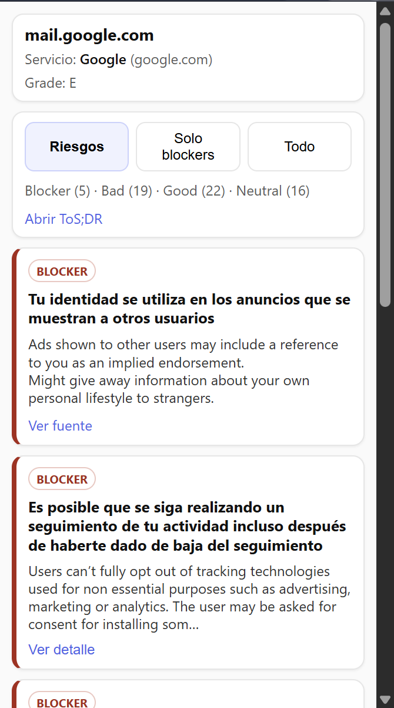

# ToS/Privacy Evidence-First

A Chrome extension (Manifest V3) that summarizes the Terms of Service and Privacy Policy of the site you are visiting, using the community ratings from [ToS;DR](https://tosdr.org). Every point it shows links back to its source, and it only makes a network request when you click **Analyze**.

## Why

Nobody reads terms of service, and most "privacy score" tools either run in the background on every page you visit or give you a verdict without showing where it came from. This extension takes the opposite approach:

- **On demand only.** No background analysis, no browsing history, no tracking.
- **Evidence first.** Each finding is a ToS;DR point with its description and a link to the original clause.
- **No false matches.** If ToS;DR has no service whose URL exactly matches the domain, it says "no coverage" instead of showing a similarly named service.

## Features

- Reduces the active tab to its registrable domain (`www.bbc.co.uk` becomes `bbc.co.uk`).
- Shows the service name, its ToS;DR grade (A to E) and a count of **Blocker**, **Bad**, **Good** and **Neutral** points.
- Filters: **Risks** (blockers and bad points, default), **Blockers only** and **All**.
- Fetches points in Spanish when available and falls back to English.
- Caches results locally for 24 hours per domain.
- Never contacts the API for `localhost`, IP addresses, intranet hosts or private TLDs (`.local`, `.lan`, `.internal`, ...).
- Subservice hint for some `google.com` paths (Maps, Flights, Search, Travel).

> The interface is currently in Spanish.

## Demo



## Tech stack

- Plain JavaScript (ES modules), HTML and CSS. No build step, no dependencies.
- Chrome Extensions Manifest V3: service worker, `activeTab`, `scripting`, `storage`.
- [ToS;DR public API](https://api.tosdr.org): `search/v5` and `service/v3`.

## Installation

1. Clone the repository:
   ```bash
   git clone https://github.com/marticoco24/tos-privacy-evidence-first.git
   ```
2. Open `chrome://extensions` in Chrome or any Chromium-based browser.
3. Turn on **Developer mode**.
4. Click **Load unpacked** and select the project folder.
5. Pin the extension, open any website and click **Analyze** (Analizar).

## How it works

1. The popup sends `ANALYZE_CURRENT_DOMAIN` with the active `tabId` to the service worker.
2. The service worker injects a one-line function (via `activeTab` and `scripting`) that returns `location.hostname` and `location.pathname`.
3. `normalizeDomain()` reduces the hostname to its registrable domain.
4. `fetchTosdrSummary()`:
   - returns the cached result if it is still valid;
   - otherwise calls `GET /search/v5?query=<domain>` and picks the service with `pickBestService()`;
   - downloads its points with `GET /service/v3?id=<id>&lang=es`, falling back to `lang=en`;
   - caches the result for 24 hours (without host or path).
5. The popup renders the result or one of these states: `ok`, `no_coverage`, `rate_limited`, `api_error`.

## Project structure

```
manifest.json                 Manifest V3: permissions, popup, service worker, CSP
background/service-worker.js  Reads the active tab's hostname and calls the ToS;DR client
lib/tosdr.js                  Domain normalization, service matching, API calls, cache
popup/popup.html              Popup markup
popup/popup.js                Rendering: header, filters, counters, point cards
popup/popup.css               Styles
icons/icon-128.png            Extension icon
```

## Permissions and privacy

| Permission | Purpose |
|---|---|
| `activeTab` | Access the current tab only after the user clicks |
| `scripting` | Read that tab's hostname and path |
| `storage` | Local result cache |
| `https://api.tosdr.org/*` | Query the ToS;DR API |

- The only thing sent to ToS;DR is the registrable domain, never the full URL or path.
- The cache lives in `chrome.storage.local` and expires after 24 hours.
- The Content Security Policy limits scripts to the extension itself and connections to `api.tosdr.org`.

## Limitations

- Does not work on internal browser pages (`chrome://`, Chrome Web Store, new tab, PDF viewer).
- Coverage depends on ToS;DR; many sites have no rating yet.
- Domain normalization uses a short list of country-code suffixes, not the full Public Suffix List.

## Credits

Data comes from [ToS;DR (Terms of Service; Didn't Read)](https://tosdr.org), a community project. This extension is not affiliated with ToS;DR.

## License

[MIT](LICENSE)
